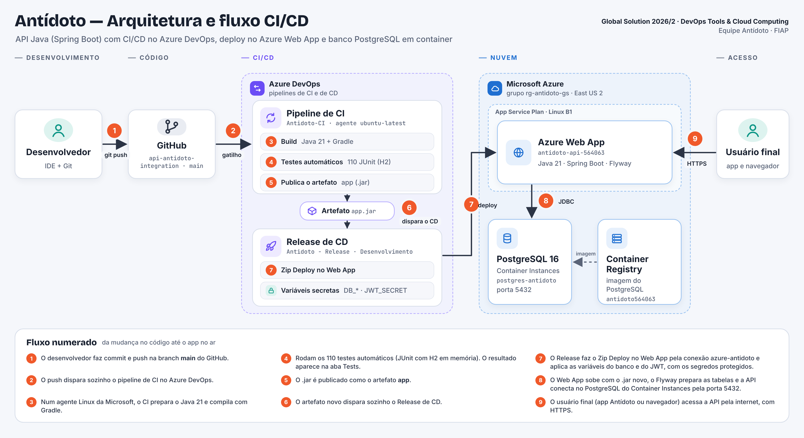

# 🦂 Antídoto — CI/CD com Azure DevOps

API REST do Antídoto em Java (Spring Boot), com integração e entrega contínuas no **Azure DevOps**, deploy automático no **Azure Web App** e banco **PostgreSQL** rodando em container na Azure.

## 👥 Integrantes

| Nome | RM | Turma |
|---|---|---|
| Gustavo Souto de Melo | RM558595 | 2TDSPW |
| Iago Liziero Pereira | RM564063 | 2TDSPW |
| Icaro José Dos Santos | RM562403 | 2TDSPW |
| Leonardo Barbosa Santos | RM558230 | 2TDSPW |

---

## 📌 Descrição da solução

O **Antídoto** é um app de orientação em acidentes com animais peçonhentos (escorpião, cobra, aranha, lagarta, abelha). No SOS, sem precisar de login, a pessoa responde poucas perguntas e recebe o nível de urgência, os primeiros socorros e as unidades de saúde mais próximas com soro compatível com o animal, com os botões de ligar e de rota. Logado, o cidadão registra a ocorrência (com um resumo de pré-atendimento para levar à unidade) e os avistamentos de animais, que ajudam a mapear os focos. Esta API é o back-end que o app consome: cadastro e login com JWT, triagem de urgência, unidades com soro, primeiros socorros, ocorrências e avistamentos.

Nesta entrega, a API ganhou uma esteira de CI/CD completa no Azure DevOps. A cada alteração na branch `main`, o código é compilado, testado e empacotado automaticamente, e a nova versão é publicada no Azure Web App sem nenhum passo manual. URL, usuário e senha do banco e o segredo do JWT ficam fora do código, como variáveis protegidas da pipeline.

### 🧰 Stack

| Camada | Tecnologia |
|---|---|
| Linguagem e framework | Java 21, Spring Boot 4 (Web MVC, Data JPA, Security, Validation, Actuator) |
| Segurança | Spring Security com JWT (JJWT, HS256) e senhas com BCrypt |
| Build | Gradle (wrapper) |
| Banco de dados | PostgreSQL 16 em container no Azure Container Instances, com migrations do Flyway |
| Testes automáticos | JUnit 5, AssertJ e MockMvc, com H2 em memória no modo PostgreSQL |
| Documentação da API | springdoc-openapi (Swagger UI) |
| IA (opcional) | Spring AI para o resumo de pré-atendimento. Desligada por padrão (`IA_HABILITADA`): sem ela, vale o resumo por modelo de texto |
| Código-fonte | GitHub (`api-antidoto-integration`, branch `main`) |
| CI/CD | Azure DevOps: pipeline de build (CI) e Release (CD) |
| Hospedagem | Azure Web App (App Service Linux, plano B1) |
| Imagem do banco | Azure Container Registry |

---

## 🏗️ Arquitetura e fluxo CI/CD



**Fluxo numerado**

1. O desenvolvedor faz commit e push na branch `main` do GitHub.
2. O push dispara sozinho o pipeline de CI no Azure DevOps.
3. Num agente Linux da Microsoft (`ubuntu-latest`), o CI prepara o Java 21 e compila com Gradle.
4. Rodam os 110 testes automáticos (JUnit com H2 em memória). O resultado aparece na aba **Tests**.
5. O `.jar` é publicado como o artefato `app`.
6. O artefato novo dispara sozinho o Release de CD.
7. O Release faz o Zip Deploy no Web App pela conexão de serviço `azure-antidoto` e aplica as variáveis do banco e do JWT, com os segredos protegidos.
8. O Web App sobe com o `.jar` novo, o Flyway prepara as tabelas e a API conecta no PostgreSQL do Container Instances pela porta 5432.
9. O usuário final (app Antídoto ou navegador) acessa a API pela internet, com HTTPS.

**Onde cada ferramenta atua**

| Componente | Papel |
|---|---|
| GitHub | Guarda o código-fonte. O push na `main` é o gatilho da esteira |
| Azure DevOps · `Antidoto-CI` | Build, testes automáticos e publicação do artefato |
| Azure DevOps · `Antidoto - Release` | Deploy automático do artefato no Web App |
| Conexão de serviço `azure-antidoto` | Dá ao Azure DevOps acesso à assinatura da Azure (Azure Resource Manager) |
| Azure Web App `antidoto-api-564063` | Executa a API (Java 21, Linux) |
| Azure Container Instances `postgres-antidoto` | Executa o banco PostgreSQL 16 |
| Azure Container Registry `antidoto564063` | Guarda a imagem do PostgreSQL usada pelo container |

---

## 🔁 Pipelines no Azure DevOps

Projeto: **_preencher com o nome do projeto_** (organização `_preencher_`, privado, Git, processo Agile).

### CI — `Antidoto-CI`

Pipeline criada pelo editor clássico, com o código vindo direto do GitHub (`api-antidoto-integration`, branch `main`).

| Ordem | Tarefa | Configuração |
|---|---|---|
| 1 | Java tool installer | JDK 21, x64, pré-instalado no agente |
| 2 | Gradle | `./gradlew build`, publica os resultados em `**/build/test-results/test/TEST-*.xml` com o título "Testes de Código" |
| 3 | Copy files | Copia `**/build/libs/*.jar` para `$(Build.ArtifactStagingDirectory)` (o build gera um `.jar` só, o executável) |
| 4 | Publish build artifacts | Publica o artefato `app` no Azure Pipelines |

- **Agente:** Azure Pipelines, `ubuntu-latest`
- **Gatilho:** integração contínua ligada na branch `main`
- **Número do build:** `$(date:yyyyMMdd)$(rev:.r)`

### CD — `Antidoto - Release`

| Item | Configuração |
|---|---|
| Artefato | Build `Antidoto-CI`, versão Latest, alias `Antidoto - CI` |
| Gatilho | Continuous deployment trigger ligado: todo artefato novo cria um Release |
| Stage | `Desenvolvimento`, agente `ubuntu-latest` |
| Tarefa | Azure App Service deploy: conexão `azure-antidoto`, Web App on Linux, `antidoto-api-564063`, pacote `$(System.DefaultWorkingDirectory)/**/*.jar`, método Zip Deploy |
| App settings | `-DB_URL "$(DB_URL)" -DB_USUARIO "$(DB_USUARIO)" -DB_SENHA "$(DB_SENHA)" -JWT_SECRET "$(JWT_SECRET)"` |

### 🔒 Variáveis protegidas

| Variável | Onde | Proteção |
|---|---|---|
| `DB_URL` | Variables do Release (escopo Release) | — |
| `DB_USUARIO` | Variables do Release (escopo Release) | — |
| `DB_SENHA` | Variables do Release (escopo Release) | Secreta (cadeado): não aparece em logs nem na tela |
| `JWT_SECRET` | Variables do Release (escopo Release) | Secreta (cadeado). Base64 de 32 bytes, gerado com `openssl rand -base64 32` |

Nenhuma senha fica no código: o `application.properties` só lê variáveis de ambiente. Sem elas (no computador e nos testes), a API usa um H2 em memória.

```properties
spring.datasource.url=${DB_URL:jdbc:h2:mem:antidoto;MODE=PostgreSQL;...}
spring.datasource.username=${DB_USUARIO:sa}
spring.datasource.password=${DB_SENHA:}
antidoto.jwt.segredo=${JWT_SECRET:}
```

Valor do `DB_URL` na Azure: `jdbc:postgresql://postgres-antidoto-564063.eastus2.azurecontainer.io:5432/antidoto`.

---

## ✅ Testes automáticos

São 110 testes. Os de API sobem a aplicação e chamam as rotas com o MockMvc, como o app faz, com login por JWT. Os de regra testam os services direto:

| Classes | O que testa |
|---|---|
| `AntidotoApiApplicationTests`, `PaginaInicialTest` | A aplicação sobe com o Flyway e o Hibernate conferindo as tabelas, a saúde responde `UP`, o Swagger e a página inicial abrem sem login |
| `AuthControllerTest`, `JwtServiceTest` | Cadastro, login, token JWT, perfil, troca de senha e 401 sem login ou com token inválido |
| `AvistamentoControllerTest` | CRUD completo do avistamento e acesso só do dono (de outro usuário é 404) |
| `OcorrenciaControllerTest` | Registro, consulta, atualização e exclusão da ocorrência, com a urgência calculada pela API |
| `UnidadeControllerTest`, `CompatibilidadeSoroServiceTest`, `DistanciaServiceTest` | Unidades mais próximas com soro compatível com o animal (Haversine) |
| `UrgenciaServiceTest` | Regras de urgência da triagem |
| `ConteudoControllerTest` | Primeiros socorros por animal, sem dose nem remédio |
| `ResumoIaServiceTest`, `ResumoIaIntegracaoTest`, `ResumoModeloPadraoTest` | Resumo de pré-atendimento: a IA com um servidor falso (nenhum teste chama a IA de verdade) e o modelo de texto de reserva |
| `TratadorGlobalDeErrosTest`, `PaginaResponseTest`, `BancoDoRenderTest` | Formato de erro, paginação e a conversão da URL do banco do Render |

Sem a variável `DB_URL`, os testes usam um H2 em memória no modo PostgreSQL, com a **mesma** migration do Flyway que roda no PostgreSQL da Azure. Assim o CI não depende do banco da nuvem estar ligado e, a cada build, confere que as tabelas batem com as entidades.

Para rodar na máquina:

```bash
./gradlew test
```

---

## ☁️ Infraestrutura na Azure

Grupo de recursos `rg-antidoto-gs`, região East US 2.

| Recurso | Nome | Detalhes |
|---|---|---|
| Container Registry | `antidoto564063` | SKU Basic, guarda a imagem `postgres:16` |
| Container Instances | `postgres-antidoto` | PostgreSQL 16, porta 5432, banco `antidoto`, acesso por `postgres-antidoto-564063.eastus2.azurecontainer.io` |
| App Service Plan | `plan-antidoto` | Linux, B1 |
| Web App | `antidoto-api-564063` | Java 21 (`JAVA:21-java21`), `https://antidoto-api-564063.azurewebsites.net` |

### Como recriar a infraestrutura (Azure CLI)

```bash
RG="rg-antidoto-gs"
LOCATION="eastus2"
ACR="antidoto564063"
DB="postgres-antidoto"
PLAN="plan-antidoto"
WEBAPP="antidoto-api-564063"

# a senha do banco é digitada na hora e não fica salva em nenhum arquivo
read -s -p "Senha do PostgreSQL: " DB_PASSWORD; echo

az group create --name $RG --location $LOCATION

# registry com a imagem do PostgreSQL
az acr create --resource-group $RG --name $ACR --sku Basic --admin-enabled true
az acr import --name $ACR --source docker.io/library/postgres:16 --image postgres:16
# se o Docker Hub limitar os downloads, adicione: --username <usuario-dockerhub> --password <token>

ACR_USER=$(az acr credential show --name $ACR --query username -o tsv)
ACR_PASS=$(az acr credential show --name $ACR --query "passwords[0].value" -o tsv)

# banco PostgreSQL em container
az container create \
  --resource-group $RG \
  --name $DB \
  --image $ACR.azurecr.io/postgres:16 \
  --os-type Linux --cpu 1 --memory 1.5 \
  --ports 5432 \
  --dns-name-label postgres-antidoto-564063 \
  --registry-login-server $ACR.azurecr.io \
  --registry-username $ACR_USER \
  --registry-password $ACR_PASS \
  --environment-variables POSTGRES_DB=antidoto POSTGRES_USER=antidoto \
  --secure-environment-variables POSTGRES_PASSWORD=$DB_PASSWORD

# plano e Web App Linux com Java 21
az appservice plan create --name $PLAN --resource-group $RG --is-linux --sku B1
az webapp create --name $WEBAPP --resource-group $RG --plan $PLAN --runtime "JAVA:21-java21"
```

A conexão com o banco e o segredo do JWT são aplicados no Web App pelo próprio Release (App settings), a partir das variáveis protegidas da pipeline.

### Ligar e desligar entre os dias de uso (economia de crédito)

O container do banco não tem volume: quando ele é desligado e ligado de novo, o banco volta vazio. Por isso, ao ligar, primeiro sobe o banco e depois reinicia o Web App: na subida, o Flyway recria as tabelas e a API cadastra de novo os usuários e as unidades de teste.

```bash
# ligar (primeiro o banco, depois o app)
az container start --resource-group $RG --name $DB
az appservice plan update --name $PLAN --resource-group $RG --sku B1
az webapp config set --name $WEBAPP --resource-group $RG --always-on true
az webapp restart --name $WEBAPP --resource-group $RG

# desligar
az container stop --resource-group $RG --name $DB
az webapp config set --name $WEBAPP --resource-group $RG --always-on false
az appservice plan update --name $PLAN --resource-group $RG --sku F1
```

---

## 🌐 Rotas

Base URL: `https://antidoto-api-564063.azurewebsites.net`

### Páginas
| Rota | Descrição |
|---|---|
| `/` | Página inicial |
| `/swagger-ui.html` | Documentação interativa (Swagger) |
| `/actuator/health` | Saúde da API e do banco |

### Autenticação e usuário
| Método | Rota | Descrição |
|---|---|---|
| POST | `/api/auth/cadastro` | Cria um cidadão e já devolve o token |
| POST | `/api/auth/login` | Login, devolve o token JWT |
| GET | `/api/usuarios/me` | Dados de quem está logado |
| PUT | `/api/usuarios/me` | Altera o nome e o telefone |
| PUT | `/api/usuarios/me/senha` | Troca a senha conferindo a atual |

### Unidades e primeiros socorros (públicas, o SOS funciona sem login)
| Método | Rota | Descrição |
|---|---|---|
| GET | `/api/unidades/proximas` | Unidades com soro compatível com o animal, da mais perto para a mais longe |
| GET | `/api/unidades` | Unidades ativas, paginadas |
| GET | `/api/unidades/{id}` | Detalhe de uma unidade |
| GET | `/api/conteudo/primeiros-socorros/{tipoAnimal}` | O que fazer e o que não fazer para cada animal |

### Avistamentos (logado)
| Método | Rota | Descrição |
|---|---|---|
| POST | `/api/avistamentos` | Registra um avistamento |
| GET | `/api/avistamentos/meus` | Avistamentos do usuário, paginados |
| GET | `/api/avistamentos/{id}` | Busca um avistamento por ID |
| PUT | `/api/avistamentos/{id}` | Atualiza um avistamento |
| DELETE | `/api/avistamentos/{id}` | Remove um avistamento |

### Ocorrências (logado)
| Método | Rota | Descrição |
|---|---|---|
| POST | `/api/ocorrencias` | Registra a picada, calcula a urgência e gera o resumo |
| GET | `/api/ocorrencias/minhas` | Histórico do usuário, paginado |
| GET | `/api/ocorrencias/{id}` | Busca uma ocorrência por ID |
| PUT | `/api/ocorrencias/{id}` | Atualiza a triagem e refaz o resumo |
| DELETE | `/api/ocorrencias/{id}` | Remove uma ocorrência |

**Usuários de teste (fictícios):** `cidadao@sospeconha.dev` e `gestor@sospeconha.dev`, os dois com a senha `Teste@123`. No Swagger, faça o login, copie o `token` e cole em **Authorize**.

---

## 🗄️ Banco de dados

As tabelas são criadas pelo Flyway (`src/main/resources/db/migration/V1__criar_tabelas.sql`) na primeira subida da API: `usuarios`, `unidades_saude`, `unidade_soros`, `ocorrencias`, `ocorrencia_sintomas` e `avistamentos`.

Para conferir os dados direto no PostgreSQL do container:

```bash
az container exec --resource-group rg-antidoto-gs --name postgres-antidoto --exec-command "psql -U antidoto -d antidoto"
```

### CRUD de avistamento com evidência no banco

1. No Swagger, faça o login em `POST /api/auth/login` e cole o token em **Authorize**.
2. **Inserir:** `POST /api/avistamentos`

   ```json
   {
     "tipoAnimal": "ESCORPIAO",
     "local": "QUINTAL",
     "latitude": -23.5614,
     "longitude": -46.6559,
     "dataHora": "2026-11-16T15:30:00Z",
     "observacao": "Escorpião amarelo perto do ralo"
   }
   ```

   ```sql
   SELECT id, tipo_animal, local_avist, observacao, criado_em, atualizado_em FROM avistamentos ORDER BY id;
   ```
3. **Atualizar:** `PUT /api/avistamentos/{id}` com o mesmo corpo e outra `observacao`, e o mesmo `SELECT` (o `atualizado_em` passa a ter valor).
4. **Consultar:** `GET /api/avistamentos/{id}` e `GET /api/avistamentos/meus`.
5. **Excluir:** `DELETE /api/avistamentos/{id}` (204) e o mesmo `SELECT`: a linha some.

---

## 🧪 Testando a esteira de ponta a ponta

1. Altere algo visível no código, por exemplo o título `<h1>` em `src/main/resources/static/index.html`.
2. Faça commit e push na `main`.
3. No Azure DevOps, o `Antidoto-CI` começa sozinho, roda os testes e publica o artefato.
4. Em seguida, um novo Release começa sozinho e faz o deploy.
5. Depois que o Release ficar verde, espere alguns minutos para o Java subir com o `.jar` novo e abra `https://antidoto-api-564063.azurewebsites.net`.

> Não use o título do Swagger para essa demonstração: um dos testes confere esse título, e o CI ficaria vermelho.

---

## 🔗 Links

- 💻 Código-fonte: _link do repositório no GitHub_
- 🔁 Projeto no Azure DevOps: _link do projeto_
- 🌐 App no ar: https://antidoto-api-564063.azurewebsites.net
- 🎥 Vídeo: _link do YouTube_

---

## 📱 Uso pelo app (Render)

A mesma API também roda no Render, com um PostgreSQL próprio, para o app Antídoto consumir no dia a dia. Os arquivos desse deploy continuam no repositório ([`render.yaml`](render.yaml) e [`Dockerfile`](Dockerfile)), e o guia completo de uso pelo app (como rodar, usuários de teste, IA do resumo, variáveis e deploy no Render) está em [`docs/README-APP.md`](docs/README-APP.md).

---

_Antídoto — Global Solution 2026/2 · FIAP_
